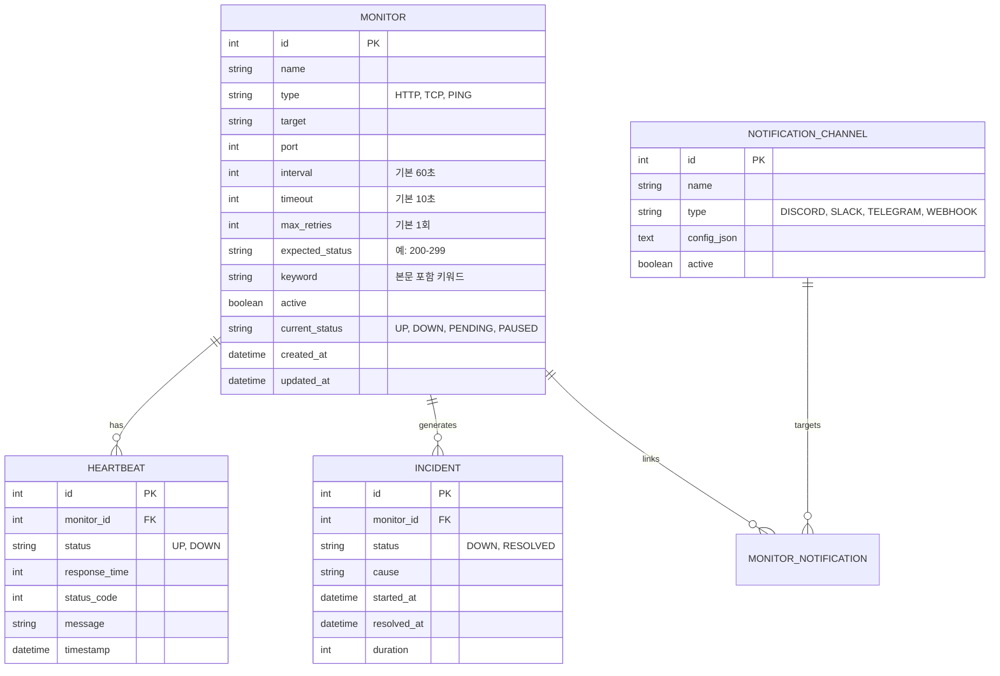

# Uptime-Health 시스템 개발 계획서 (PLAN.md)

Uptime Kuma의 핵심 가치인 **"가볍고, 직관적이며, 배포하기 쉬운 셀프 호스팅 모니터링 도구"**를 모티브로 하여 멀티 프로토콜(HTTP, TCP, Ping) 헬스체크와 크로스 플랫폼(데스크톱 & 모바일 웹) 실시간 대시보드를 구축하기 위한 계획서입니다.

---

## 1. 프로젝트 목표 및 핵심 요구사항

### 1.1 핵심 가치
1. **Zero-Config에 가까운 설치 및 실행**: 복잡한 외부 DB(PostgreSQL, Redis 등) 설정 없이 단일 프로세스/경량 내장 SQLite로 구동.
2. **신뢰성 있는 멀티 프로토콜 헬스체크**: **HTTP(S), TCP Port, ICMP Ping**의 주기적 프로빙(Probing), 타임아웃, 재시도 제어.
3. **크로스 플랫폼 반응형 UI (데스크톱 & 모바일 웹 완벽 대응)**: 데스크톱 대화면부터 스마트폰 모바일 브라우저까지 최적화된 반응형 UX/UI 및 PWA 지원.
4. **직관적인 실시간 시각화**: 서비스별 가동 상태(Heartbeat bar), 응답 속도(Latency chart), 장애 로그를 WebSocket 무새로고침으로 실시간 확인.
5. **즉각적인 장애 알림**: 상태 변경(UP $\leftrightarrow$ DOWN) 시 인시던트 관리 및 외부 채널(Discord/Slack/Telegram/Webhook) 알림 발송.

---

## 2. 시스템 아키텍처 개요

### 2.1 전체 데이터 플로우
```mermaid
flowchart TD
    subgraph UI ["Frontend (데스크톱 & 모바일 웹)"]
        A[Responsive Dashboard]
        B[Realtime Updates (WebSocket)]
        PWA[PWA / Mobile Web Optimizations]
    end

    subgraph Core ["Backend Engine"]
        C[API Server (Fastify REST / RPC)]
        D[Scheduler & Worker Pool]
        E[Probe Executor (HTTP / TCP / Ping)]
        F[Notification Dispatcher]
    end

    subgraph Storage ["경량 데이터 저장소"]
        G[(Embedded SQLite - node:sqlite)]
    end

    A <-->|REST / WS| C
    PWA -.-> A
    C --> G
    D -->|주기적 트리거| E
    E -->|헬스체크 결과| D
    D -->|결과 저장| G
    D -->|상태 전이 시 알림| F
    D -.->|실시간 전송| B
    F -->|Webhook / Bot API| Ext[외부 알림 채널 (Discord/Slack/Telegram)]
```

### 2.2 화면 모드별 UI 레이아웃 전략

```
[ 데스크톱 일반 브라우저 레이아웃 (Wide 2-Pane) ]
┌───────────────────────────┬────────────────────────────────────────────────────────┐
│ Header: Uptime-Health     │ System Summary (UP: 3 / DOWN: 0 / Overall 100%)       │
├─────────────┬─────────────┴────────────────────────────────────────────────────────┤
│ Search / Add│ Selected Monitor: Google Web [HTTP]                                  │
├─────────────┤ Status: UP  | Latency: 218ms | 24h Uptime: 100%                      │
│ • Google Web│ Heartbeat Bar (최근 60회 점검): [■■■■■■■■■■■■■■■■■■■■■■■■■■■■■■■■■■■■]  │
│   218ms 100%│──────────────────────────────────────────────────────────────────────│
│ • DNS TCP   │ Realtime Latency Line Chart (응답속도 그래프)                        │
│   10ms  100%│──────────────────────────────────────────────────────────────────────│
│ • Ping      │ Recent Incidents / Probe Logs (이력 테이블)                          │
│   1ms   100%│                                                                      │
└─────────────┴──────────────────────────────────────────────────────────────────────┘

[ 모바일 웹 브라우저 레이아웃 (Single-Column & Touch Friendly) ]
┌─────────────────────────────────┐
│ ☰ Uptime-Health     [● 실시간]  │
├─────────────────────────────────┤
│ 📊 가동 요약: 3 UP / 0 DOWN      │
├─────────────────────────────────┤
│ ┌─ Google Web [HTTP] ─────────┐ │
│ │ 상태: UP (218ms) • 100%     │ │
│ │ 하트비트: [■■■■■■■■■■■■■■■]  │ │  (화면 너비 자동 축소 적응 - 32블록)
│ └─────────────────────────────┘ │
│ ┌─ Cloudflare DNS TCP ────────┐ │
│ │ 상태: UP (10ms)  • 100%     │ │
│ │ 하트비트: [■■■■■■■■■■■■■■■]  │ │
│ └─────────────────────────────┘ │
├─────────────────────────────────┤
│ [ 🏠 홈 ]  [ ➕ 추가 ]  [ ⚙ 설정 ] │  (Bottom Navigation Bar 제공)
└─────────────────────────────────┘
```

### 2.3 아키텍처 핵심 컴포넌트
1. **Probe Engine (멀티 프로토콜 프로빙 엔진)**
   - **HTTP(S) Prober**: 상태 코드 검증(200-299 등), 응답 시간(Latency), 본문 키워드 매칭, 타임아웃
   - **TCP Port Prober**: 지정된 Host:Port 소켓 연결 및 RTT 측정 (DB, SSH, Redis 등 점검)
   - **ICMP Ping Prober**: 크로스 플랫폼(Windows/Linux) Ping 실행 래퍼로 권한 제약 없이 패킷 왕복 시간 및 손실률 점검
2. **State Machine & Scheduler (상태 전이 머신 & 스케줄러)**
   - 일시적 네트워크 튐으로 인한 오탐(False Positive) 방지를 위한 **재시도 정책(`max_retries`)** 지원.
   - 상태 변경(`UP` $\leftrightarrow$ `DOWN`) 시 인시던트 자동 기록 및 실시간 WebSocket 브로드캐스트.
3. **Storage (임베디드 SQLite)**
   - Node.js 24 내장 `node:sqlite` 사용으로 외부 의존성(C++ 컴파일 등) 없이 파일 하나(`data/uptime.db`)로 영속화.
   - 모니터당 최근 2,000건 유지 정책으로 DB 경량화 유지.

---

## 3. 기술 스택

| 영역 | 선정 기술 | 선정 이유 |
|:---|:---|:---|
| **백엔드 프레임워크** | **Fastify (Node.js 24 + TypeScript)** | 고성능, 내장 로거, 간결한 비동기 라우팅 및 WebSocket 통합 |
| **데이터베이스** | **Node.js 내장 SQLite (`node:sqlite`)** | 무설정(Zero-config), C++ 네이티브 컴파일 불필요, 고성능 |
| **실시간 통신** | **WebSocket (`@fastify/websocket`)** | 실시간 하트비트 및 상태 전이 즉시 브로드캐스트 |
| **프론트엔드 프레임워크**| **React 19 + TypeScript + Vite** | 빠른 빌드/HMR, 최신 리액트 에코시스템 |
| **스타일링** | **Tailwind CSS v4** | 모바일 퍼스트 반응형 디자인, OLED 다크 테마 |
| **아이콘 / 차트** | **Lucide React + Custom SVG Chart** | 번들 크기 최소화, 가벼운 시계열 지연시간 차트 |

---

## 4. 데이터베이스 모델 설계 (SQLite)



---

## 5. 단계별 구현 로드맵

### Phase 1: Minimal Viable Monitor (코어 프로빙 엔진 & 백엔드) [완료]
- [x] Node.js 24 + TypeScript + Fastify + 내장 `node:sqlite` 환경 구성
- [x] 기본 데이터 모델 및 인덱스 마이그레이션 (`monitors`, `heartbeats`, `incidents`)
- [x] 멀티 프로토콜 프로버 엔진 구현 및 검증:
  - [x] HTTP/HTTPS Prober (상태 코드, Latency, Keyword, Timeout)
  - [x] TCP Port Prober (Socket Connection, RTT, Port Open/Closed)
  - [x] Ping ICMP Prober (크로스 플랫폼 시스템 Ping 래퍼)
- [x] 주기적 스케줄링 워커 구현 (`SchedulerService`)
- [x] REST API 및 실시간 WebSocket 브로드캐스트 구현

### Phase 2: 크로스 플랫폼 대시보드 UI (데스크톱 & 모바일 웹) [완료]
- [x] React + Vite + TailwindCSS 기반 프론트엔드 환경 구축
- [x] 데스크톱 와이드 2-Pane 레이아웃 (사이드바 + 메인 패널)
- [x] 모바일 웹 최적화 뷰 (카드형 레이아웃, Bottom Nav, 터치 친화적 UI)
- [x] Uptime Kuma 스타일 Responsive Heartbeat Bar (터치/호버 툴팁)
- [x] 초경량 SVG 실시간 Latency 추이 라인 차트
- [x] 모니터 등록 모달 및 등록 전 "사전 연결 테스트(Test)" 기능
- [x] 수동 즉시 점검(Probe Now) 및 삭제 액션

### Phase 3: 장애 탐지 및 알림 시스템 (Notification) [예정]
- [ ] 알림 채널 디스패처 모듈 구현:
  - Discord Webhook (임베드 카드 전송)
  - Telegram Bot (메시지 알림)
  - Slack Incoming Webhook
  - Generic Webhook (JSON payload)
- [ ] 테스트 알림 발송 기능
- [ ] 알림 채널 관리 UI

### Phase 4: 기능 고도화 및 패키징 [예정]
- [ ] SSL/TLS 인증서 만료 잔여일 체크 및 사전 알림
- [ ] 유지보수 모드 (Maintenance Window - 특정 시간대 알림 음소거)
- [ ] Public Status Page (비로그인 공개 상태 열람 페이지)
- [ ] 단일 Dockerfile 및 Docker Compose 배포 패키지 구성
